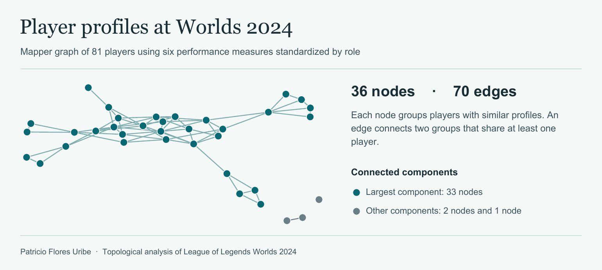

# Mapping player styles at Worlds 2024

Which players had similar performance profiles once I accounted for their roles? I analyzed aggregate statistics for **81 players on 16 teams** at the 2024 League of Legends World Championship. I used topological data analysis to see how players compared across six measures at once, then tested whether the shape of a roster added information about its observed win rate.

[Python notebook with executed outputs](Worlds_2024_Analysis.ipynb) · [One-page project brief](Worlds_2024_Topological_Analysis.pdf)

## From player statistics to team profiles

I standardized KDA, gold per minute, damage per minute, creep score per minute, kill participation and vision score per minute **within each position**. A support player's resource use was therefore compared with other supports. To represent a team, I selected its most-played player in each of the five positions and concatenated the six measures in a fixed role order. This produced a 30-dimensional vector per team.

## What the topology showed

I used a one-dimensional PCA projection as the lens for Mapper and clustered similar players within overlapping intervals. Two nodes are linked when they share a player. In the selected configuration, **33 of 36 nodes** were in one connected component. The graph had 70 edges across three components. For those settings, most groups of player profiles could be connected through intermediate groups.

I also computed Vietoris–Rips persistent homology on the original distance spaces. This tracks how components and loops appear and disappear as the distance threshold changes. The player cloud had 43 features in first homology (H1) and the team cloud had two. These are features of point clouds of different sizes and dimensions, so their counts alone do not rank the complexity of players and teams.

## Did those features add information?

I encoded each roster’s persistence diagrams using persistence images and Betti curves. I left one team out at a time and estimated its observed mean win rate from the other 15. Linear regression produced an **R² of 0.723** with role statistics, **−2.206** with topology alone and **0.816** when I combined them. The improvement depended on the model. For random forest regression, adding topology lowered R² from 0.524 to 0.195.

In a separate classification, the combined logistic model placed **14 of 16 teams** on the correct side of the sample’s median team win rate, compared with 11 using role statistics and 10 using topology alone.

These are retrospective comparisons across 16 teams. The input contains one row per player and no match timestamps. Its exact match coverage is unknown. Some preprocessing used the full sample, including standardization and the grids used to encode persistence diagrams. Testing a forecast would require dated inputs and preprocessing fitted separately within each training split.

## Running the notebook

You can read the saved outputs directly on GitHub. To rerun, place `player_statistics_cleaned_final.csv` beside the notebook, launch Jupyter in that directory and run the cells in order. The notebook lists its Python dependencies and writes figures to `figures/` and interactive Mapper graphs to `outputs/`. The SHA-256 checksum for the exact 81-row, 27-column input used for the saved results is `86b95f1b49bab9555f00618e165df4b0c56fabe31cb86f1f6462034ac3a04041`.

Kaggle lists a same-named 11.35 kB CSV in *2024 LoL Championship Player Stats & Swiss Stage* by anxuanng (@anmatngu), with an MIT license and a last update of October 26, 2024, before the final. The checksum above lets you compare a download with the analyzed file. The notebook's supplementary bracket analysis adds final standings separately. [Kaggle data card and download](https://www.kaggle.com/datasets/anmatngu/2024-lol-championship-player-stats-and-swiss-stage)

A public mirror also runs end to end if you save its CSV as `player_statistics_cleaned_final.csv`. It has the same columns and player order. The only difference beyond numerical rounding is crisp’s kill participation, which is 0.750 in the mirror and approximately 0.751 in the analyzed file. The main Mapper graph still has 36 nodes and 70 edges. The combined linear model’s R² changes to 0.780. [Alternate CSV](https://github.com/gaomengsuanjia/-LOL-S14-/blob/main/data/data.csv)

Individual project by [Patricio Flores Uribe](https://github.com/PatoFloresU).
